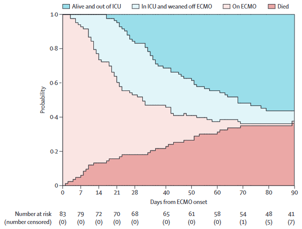

<!-- README.md is generated from README.Rmd. Please edit that file -->

```{r, include = FALSE}
knitr::opts_chunk$set(
  collapse = TRUE,
  comment = "#>",
  fig.path = "man/figures/README-",
  out.width = "100%"
)
```

# ggstackedsurv

<!-- badges: start -->

<!-- badges: end -->

The `ggstackedsurv` package makes the generation of stacked survival probability plots with [`ggplot2`](https://ggplot2.tidyverse.org/) easier. It draws heavily from the syntax and the style of [`ggsurvfit`](https://www.danieldsjoberg.com/ggsurvfit/).

## What are "stacked probability plots"?

Stacked probability plots are an efficient way to visualize the probabilities of being in each state of a multi-state model over time. Since all patients have to be in one of the states, the probabilities of being in each state at a given time always sum to 1, making for a nice and compact visualization.

A good example can be found in this 2020 [paper](https://www.thelancet.com/journals/lanres/article/PIIS2213-2600(20)30328-3/fulltext) about extra-corporeal membrane oxygenation (ECMO) in COVID-19 patients [@schmidt2020]

{width="15cm"}

## Why ggstackedsurv ?

Originally, the plan was to add these functions as a functionality to the [`ggsurvfit`](https://www.danieldsjoberg.com/ggsurvfit/) package. However, stacked probability plots are uncommon and out of the scope of [`ggsurvfit`](https://www.danieldsjoberg.com/ggsurvfit/), so making it a separate package seemed the right choice.

Plotting stacked probabilities is already possible with the [`plot.trans()`](https://search.r-project.org/CRAN/refmans/mstate/html/probtrans.html) function from the `mstate` package. However, two **crucial** (imho) functionalities were lacking:

- rendering the plot with [`ggplot2`](https://ggplot2.tidyverse.org/), which allows for limitless and easy customization, and easy exporting,
- working with models from the [`survival`](https://cran.r-project.org/web/packages/survival/index.html) package, since it is the one mostly used for survival models (even mutlistate ones).

## Installation

You can install `ggstackedsurv` from CRAN with:

``` r
install.packages("ggstackedsurv")
```

You can install the development version of `ggstackedsurv` from [GitHub](https://github.com/) with:

``` r
# install.packages("pak")
pak::pak("ABohynDOE/ggstackedsurv")
```

## Examples

The package is quite simple and only produces one type of figure, as shown in the code below

```{r, fig.width=6, fig.height=4.5, fig.align='center', echo=TRUE}
library(ggstackedsurv)
library(survival)

# Create a multi-state model using the ecmo example data
fit <- survfit(Surv(time, status) ~ 1, data = ecmo)

# Plot the survival probabilities of each state over time
ggstackedsurv(fit, base_state = "on ECMO") +
  add_risktable()
```